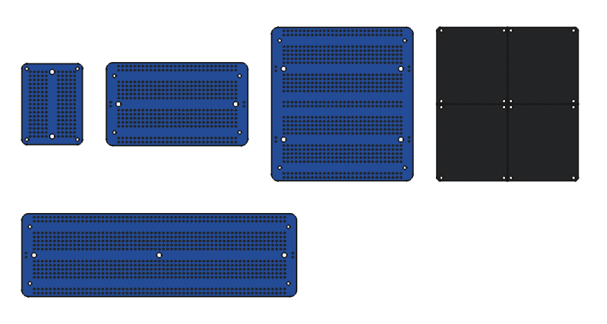

# ElectroCookie protoboard CAD models

STEP and STL models of five ElectroCookie solderable breadboard-style protoboards, plus the
parametric FreeCAD source. Use them to design enclosures, mounts and stand-offs.

**License: [CC0 1.0](LICENSE), public domain.** Use, copy, modify, sell and redistribute for
any purpose, commercial or not, with no attribution required.

## Boards

| Board | File stem | Size, mm | Mount holes (centre to centre, mm) | Grid holes |
| --- | --- | --- | --- | --- |
| Mini (1/4 size) | `electrocookie-mini` | 38.1 × 50.8 | 4 × M2 at 31.8 × 44.5; 2 × M3 on the centre line, 40.6 apart | 170 |
| Half size | `electrocookie-half` | 88.9 × 52.1 | 4 × M2 at 78.7 × 35.6; 2 × M3 on the centre line, 73.7 apart | 424 |
| Full size | `electrocookie-full` | 172.7 × 52.1 | 4 × M2 at 162.6 × 35.6; 3 × M3 on the centre line, 78.7 pitch | 886 |
| Dual half size | `electrocookie-dual` | 88.9 × 96.5 | 4 × M2 at 78.7 × 80; 4 × M3 at 73.7 × 44.5 | 788 |
| Snappable (4 pieces, V-cut) | `electrocookie-snappable` | 88.9 × 96.5 | 16 × M2, 4 per piece | 1244 |

M2 holes are Ø2.2 mm and M3 holes are Ø3.2 mm. Grid holes are Ø1.0 mm on a 2.54 mm (0.1 in) pitch.

## Files

Each board comes in two versions:

- `step/<stem>.step`, `stl/<stem>.stl`: outline, mounting holes and, on the snappable board, V-cuts.
  Small and fast; use this version for enclosure design.
- `step/<stem>-holes.step`, `stl/<stem>-holes.stl`: the same board with every 2.54 mm grid hole, the power rails
  and the power-jumper holes cut through.

Every model has its origin at the board centre, Z = 0 on the bottom face, the board in the XY plane
and the long dimension drawn as on ElectroCookie's own drawings.

`freecad/ElectroCookie.FCStd` is the parametric source (FreeCAD 1.x / 27.1). Every dimension is in the
`params` spreadsheet. Plain boards are PartDesign Bodies. The hole variants show the grid as
light 2D marks (Draft link arrays of a single circle), so the document recomputes in under a second.
The `-holes` files have the grid cut through.

## Accuracy

Outlines, mounting-hole positions and hole diameters come from the dimension drawings in ElectroCookie's
product listings. These values were estimated from photos and are unconfirmed:

- board thickness 1.6 mm;
- corner radii: Mini 3 mm, Half / Full / Dual 4 mm, Snappable 2 mm;
- power-rail rows 21.3 mm and 23.9 mm from the breadboard centre line;
- grid hole diameter 1.0 mm;
- snappable board mounting-hole positions, aligned to the grid, within about ±0.3 mm (the drawing gives no hole positions).

Measure your own board before you rely on a tight fit, and please open an issue or pull request
with caliper readings.

## Disclaimer

This is an independent community model. It is not made, endorsed or supported by ElectroCookie.
"ElectroCookie" is used only to identify which boards the models fit.
